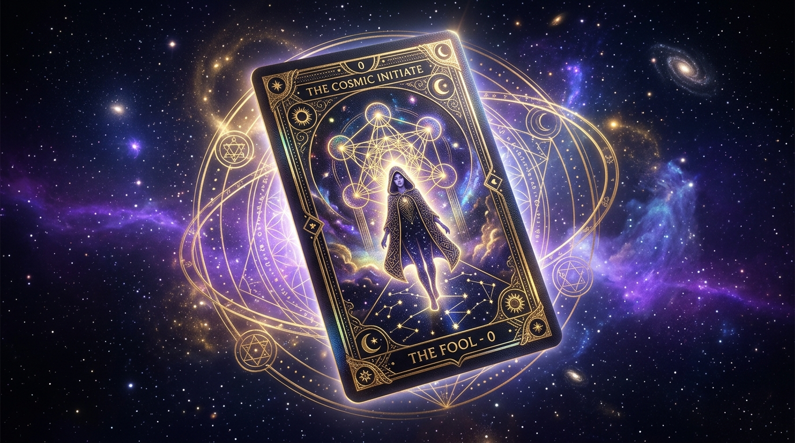

# ◈ TuSuperCard · Smart Digital Business Cards & QR Showcase ◈

[](https://opensource.org/licenses/MIT)
[](https://developer.mozilla.org/es/docs/Web/JavaScript)
[](https://pages.github.com/)
[](#-4-sistema-de-audio-nativo-y-háptico)

> *"Tu tarjeta de presentación digital interactiva: comparte proyectos, perfiles profesionales, repositorios y canales de contacto directo con físicas 3D y códigos QR instantáneos."*



**TuSuperCard** es una plataforma web moderna, rápida y profesional para centralizar todos tus enlaces de contacto, perfiles de desarrollo y portafolio en un formato de **tarjetas inteligentes interactivas en 3D**.

---

## 🌟 Características Destacadas

### 🎴 1. Tarjetas Interactivas con Físicas 3D
- **Baraja Apilada Dinámica**: Las tarjetas se presentan en un mazo físico en 3D con sensación de profundidad, sombras realistas y rotaciones naturales.
- **Modo Selección Aleatoria o Secuencial**: Navega tarjeta por tarjeta con transiciones fluidas de giro en 3D.
- **Efecto Abanico Expandido**: Despliega todas las tarjetas de la sección en un abanico radial para seleccionar cualquier enlace directamente.
- **Brillo y Reflejo Dinámico**: Efecto holográfico interactivo que reacciona suavemente al cursor del ratón o inclinación en dispositivos móviles.
- **Soporte Táctil Completo**: Desliza (swipe) a la izquierda o derecha en smartphones para navegar rápidamente.

### 🌐 / ⚡ 2. Organización Dual de Secciones
- **Perfil Público**: Enlaces profesionales y de divulgación — Portafolio, GitHub Oficial, LinkedIn, Currículum / Resume, X / Twitter y Laboratorio Visual.
- **Contacto Directo**: Canales de comunicación directa y accesos inmediatos — WhatsApp Business, Calendly para reuniones, Telegram directo, Correo Corporativo, Enlace de Pagos / Finanzas y Credenciales Wi-Fi de Oficina.

### 📋 3. Catálogo Rápido con Buscador y Filtros
- Conmuta a la vista **Catálogo Rápido** para ver todas las tarjetas organizadas en una cuadrícula moderna y responsiva.
- **Buscador en Tiempo Real**: Filtra instantáneamente por título, tipo, descripción o enlace URL.
- **Filtros por Categoría**: Píldoras interactivas para segmentar por `Desarrollo`, `Social`, `Contacto`, `Agenda`, `Finanzas`, etc.

### 🔔 4. Sistema de Audio Nativo y Háptico
- Diseñado con retroalimentación sonora sutil, moderna y profesional (Web Audio API):
  - Clic háptico suave al seleccionar tarjetas.
  - Tono suave de transición al girar y consultar el reverso con el código QR.
  - Chime moderno de confirmación al copiar o compartir enlaces.
- **Sin archivos de audio externos**: Generación de frecuencias puras 100% offline sin peticiones de red.
- Opción de silenciar accesible en la barra superior con persistencia en `localStorage`.

### ⚙ 5. Panel de Gestión & Personalización Integrado
- **Pestaña Tarjetas de Enlaces**: Agrega nuevas tarjetas o modifica existentes (título, etiqueta, código numeral, categoría, ícono vectorial, color y URL).
- **Pestaña Perfil Profesional**: Actualiza el nombre del titular, título del hub, cargo/subtítulo y descripción profesional en tiempo real.
- **Pestaña Publicación & Respaldo**: Descarga el archivo `cards-data.js` listo para actualizar tu repositorio de GitHub, copia/importa la configuración completa en JSON o restablece los valores originales.

### 📥 6. Descarga de Tarjetas Profesionales en PNG de Alta Resolución
- Al pulsar **"Descargar QR"**, el motor genera en el navegador mediante HTML5 Canvas una **tarjeta de presentación ejecutiva de 640x940px** lista para imprimir o compartir:
  - Diseño ejecutivo en azul cobalto y pizarra oscura.
  - Código y tipo de tarjeta con tipografía moderna Plus Jakarta Sans.
  - Código QR generado con corrección de errores nivel H y compatibilidad UTF-8 completa.
  - URL legible y formateada.
  - Lista para imprimir en formato tarjeta de visita, stickers o compartir en redes.

### ⌨ 7. Accesibilidad y Atajos de Teclado
- <kbd>←</kbd> / <kbd>→</kbd> : Pasar a la tarjeta anterior o siguiente.
- <kbd>Espacio</kbd> : Girar la tarjeta para ver el reverso con el código QR.
- <kbd>Enter</kbd> : Abrir el enlace directo en una nueva pestaña.
- <kbd>Escape</kbd> : Regresar a la vista principal o cerrar el panel de control.

---

## 🚀 Despliegue en GitHub Pages (Gratis en 3 Minutos)

El repositorio incluye un archivo `.nojekyll` para asegurar compatibilidad total con GitHub Pages:

1. **Haz un Fork** o clona este repositorio en tu cuenta:
   ```bash
   git clone https://github.com/maximoGs/TuSuperCardWeb.git
   ```
2. **Personaliza tus datos**:
   - Abre `index.html` en tu navegador.
   - Pulsa en **"Panel de Control"** (arriba a la derecha).
   - Edita tu información profesional y personaliza tus enlaces y tarjetas.
   - En la pestaña **"Publicación & Respaldo"**, haz clic en **"Descargar cards-data.js"**.
   - Reemplaza el archivo descargado en tu carpeta `js/cards-data.js`.
3. **Sube tus cambios a GitHub**:
   ```bash
   git add .
   git commit -m "feat: personalizar perfil y tarjetas profesionales"
   git push origin main
   ```
4. **Activa GitHub Pages**:
   - En GitHub, dirígete a **Settings → Pages**.
   - En **Branch**, selecciona `main` y el directorio `/ (root)`.
   - Haz clic en **Save**. En 1 minuto tendrás tu Hub profesional en línea:
     `https://tu-usuario.github.io/TuSuperCardWeb/`

---

## 💻 Ejecución Local

No requiere Node.js, compiladores ni procesos de build complejos:

### Opción 1: Con cualquier navegador
Simplemente abre `index.html` en tu navegador web.

### Opción 2: Con servidor local de desarrollo
Si tienes Node.js instalado:
```bash
# Iniciar servidor local en el puerto 3000
npm start
# O alternativamente:
npm run dev
```

---

## 📁 Estructura del Proyecto

```
TuSuperCardWeb/
├── .nojekyll                 # Configuración de bypass para GitHub Pages
├── index.html                # Estructura semántica, accesibilidad y modales
├── package.json              # Metadatos del proyecto y scripts
├── README.md                 # Documentación técnica y guía de uso
├── assets/                   # Recursos gráficos e imágenes
│   ├── favicon.svg           # Ícono vectorial de tarjeta inteligente
│   └── og-preview.jpg        # Vista previa para Open Graph y redes sociales
├── css/
│   ├── style.css             # Sistema de diseño, tokens de color y layout
│   └── animations.css        # Animaciones de física 3D, hover y transiciones
└── js/
    ├── qrcode.min.js         # Motor de generación de códigos QR
    ├── cards-data.js         # Base de datos predeterminada y gestor de persistencia
    ├── sigils.js             # Biblioteca de íconos vectoriales SVG optimizados
    ├── celestial-canvas.js   # Fondo digital con partículas y retícula interactiva
    ├── audio.js              # Efectos de audio hápticos con Web Audio API
    ├── deck-engine.js        # Motor de tarjetas 3D, abanico, catálogo y exportación PNG
    └── app.js                # Controlador principal y gestión del panel de configuración
```

---

## 🎨 Personalización en Código (`js/cards-data.js`)

También puedes editar las tarjetas directamente en el código fuente:

```javascript
{
  id: "pub-1",
  deck: "public",             // 'public' (Perfil Público) o 'personal' (Contacto Directo)
  numeral: "01",              // Código identificador
  archetype: "PORTFOLIO",     // Etiqueta de la tarjeta
  title: "Sitio Web & Proyectos", // Título principal
  destination: "Casos de estudio, arquitectura y desarrollos", // Descripción
  url: "https://github.com/maximoGs", // Enlace y destino del QR
  category: "Proyectos",      // Categoría para el buscador
  accentColor: "#3b82f6",     // Color de acento
  sigil: "code",              // code, github, linkedin, whatsapp, telegram, mail, compass, scroll, hourglass, feather, wave, antenna, eye, chalice
  glowType: "sapphire"        // sapphire, emerald, gold, ruby, amethyst, crystal
}
```

---

## 📜 Licencia

Distribuido bajo la **Licencia MIT**. Siéntete libre de utilizar, adaptar y compartir tu propio Hub profesional.

Creado por [Máximo](https://github.com/maximoGs)
